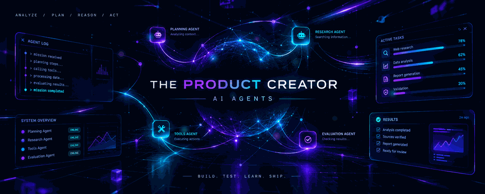

  

 
 

# AI Engineer in the Making

### Learning AI. Building agents. Creating products.

*I turn ideas into experiments. Experiments into products.*

---

## ⚡ About Me

I'm a student exploring the world of **Data and Artificial Intelligence**, learning by building practical projects.

My current interests include:

- 🤖 AI agents and agentic systems
- 🧠 AI engineering and LLM-based applications
- 🛠️ Turning ideas into useful products
- 📈 Learning through experimentation and iteration

I'm at the beginning of my journey, and this GitHub profile documents my progress, projects, and lessons learned along the way.

## 🚀 Featured Project

### 🧪 AgentLab — Mission Planner

*A small Python project exploring how an AI agent can break a mission into structured steps.*

- **Goal:** Turn a user-defined mission into an actionable plan.
- **Current stage:** Initial implementation in progress.
- **Next steps:** Add tests, improve planning logic, and explore tool integration.

> The initial version is a deterministic planner — a foundation for future agent experiments, not yet an autonomous AI agent.

<!-- When the project is ready, add its repository link here. -->

## 🗺️ Roadmap

- [ ] Strengthen Python fundamentals
- [ ] Build and document small AI projects
- [ ] Learn how LLMs work and how to integrate them into applications
- [ ] Experiment with tool calling and agent workflows
- [ ] Explore evaluation, reliability, and testing
- [ ] Learn deployment and LLMOps fundamentals
- [ ] Ship a complete AI-powered product

## 🧩 Engineering Principles

- **Build first.** Learn by creating practical things.
- **Test assumptions.** Don't trust a result without checking it.
- **Keep it simple.** Prefer understandable solutions over unnecessary complexity.
- **Document the journey.** Share what worked, what failed, and what changed.
- **Ship and iterate.** Improve projects through feedback and experimentation.

## 🛠️ Tech Stack

**Currently learning**
- Python
- Git and GitHub
- Data and AI fundamentals

**Exploring next**
- LLM APIs and AI application development
- Agent workflows and tool calling
- Testing, deployment, and observability

*This list evolves as I build and learn.*

## 📌 Engineering Log

For each meaningful experiment, I'll aim to document:

`EXPERIMENT → OBSERVATION → FAILURE → FIX → RESULT`

The goal is not to look like an expert overnight. It's to become a better engineer, one project at a time.

---

### BUILD. TEST. LEARN. SHIP.

*Curiosity into code. Ideas into products.*

